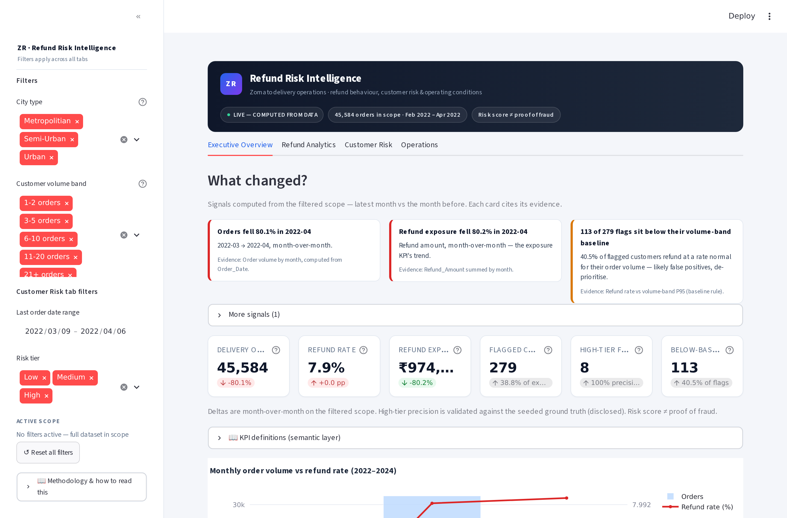
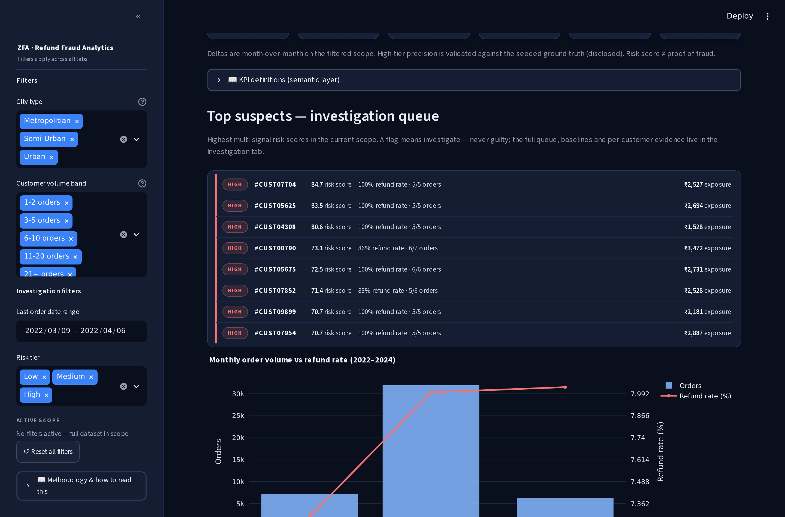
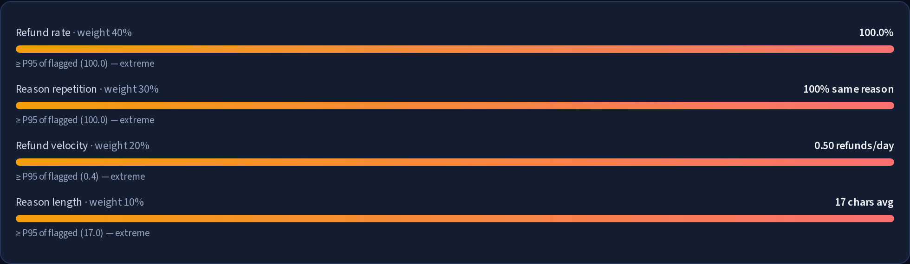
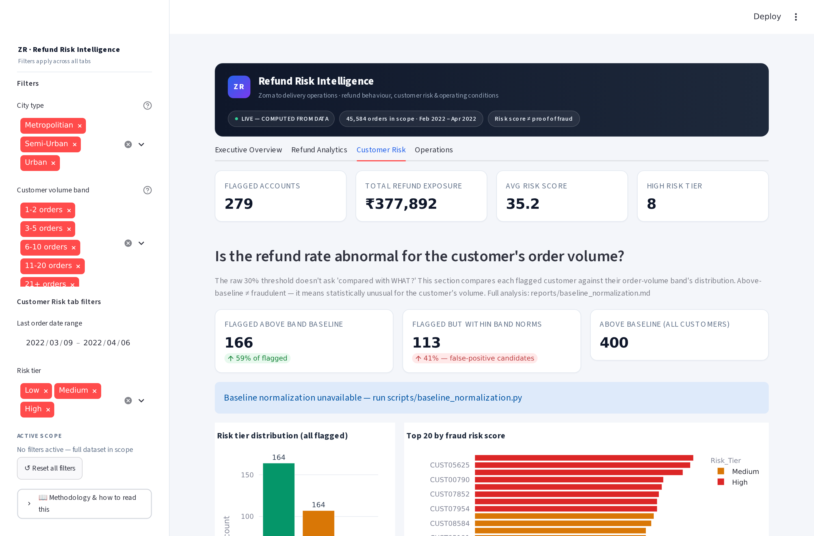
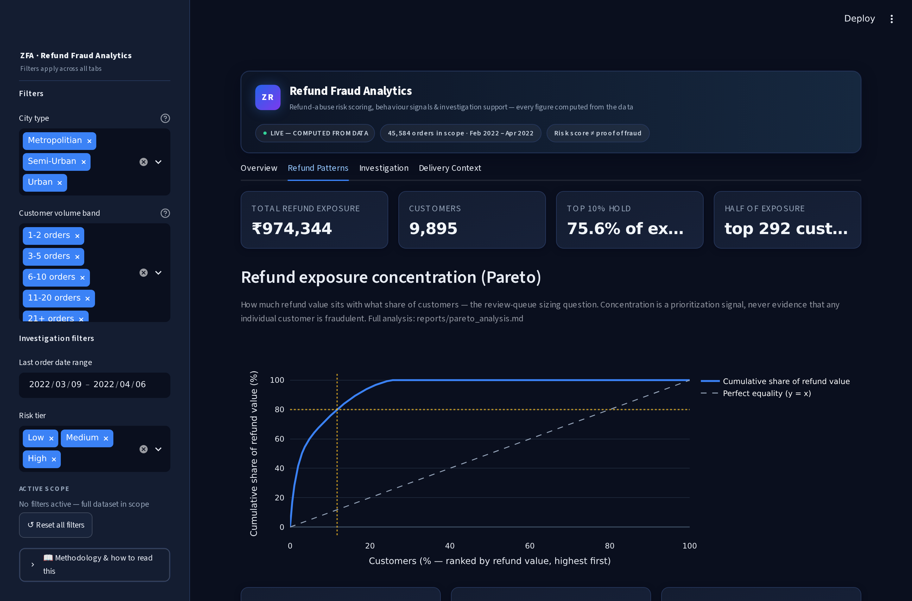
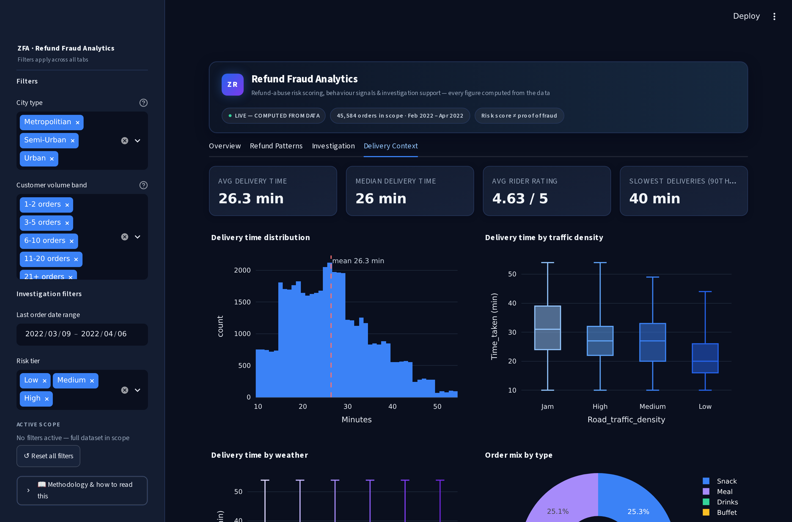
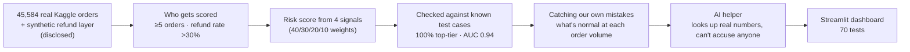
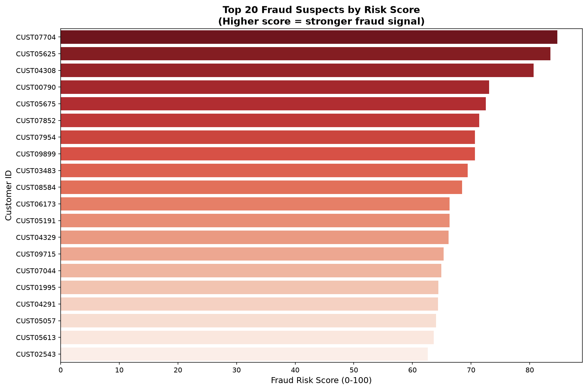
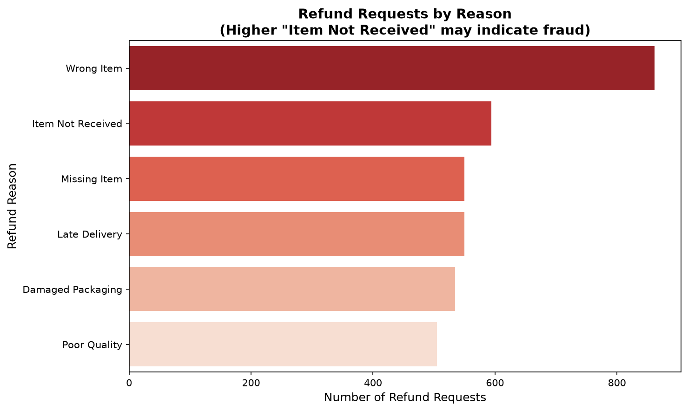

<div align="center">

# 🛡️ Zomato Refund Fraud Analytics
### Finding suspicious refund patterns in food-delivery orders — and reviewing them fairly

**The question I set out to answer:** how can a food-delivery platform spot
suspicious refund behaviour, decide who to review first, and do it without
punishing genuine customers?

[🚀 Live Dashboard](https://zomato-refund-fraud-analytics-3xu24nq5hwbml78hkyirje.streamlit.app/) ·
[🧪 70 Automated Tests](tests/) ·
[📊 Score Validation](reports/score_validation.md) ·
[🤖 Rules vs ML](reports/model_comparison.md) ·
[📄 Reports](reports/) ·
[🎤 Interview Prep](reports/interview_prep.md) ·
[🧮 Scoring Methodology](docs/risk_scoring_methodology.md)

</div>

## What you get when you open it

> Open the dashboard cold and you know what to do next: **what changed → where
> the money is concentrated → who to review first → what it costs to get it wrong.**



| What | What it does |
|---|---|
| 📌 **Month-over-month changes** | What moved this month vs last, computed from the data you're viewing — each card shows where its number comes from |
| 📊 **The headline numbers** | 6 cards: 45,584 orders · ₹974,344 in refunds · 279 customers flagged (38.78% of refund value) · 8 high-priority flags, all confirmed against known test cases · 113 likely false positives |
| 🧭 **Filters that apply everywhere** | Filter by city type, customer volume, or risk tier — the sidebar always shows what's included, one click resets |
| 🕵️ **Review list** | Who to look at first (Investigate first / Watchlist / Routine review), colour-coded by tier, exportable to CSV |
| 🔑 **One takeaway per view** | What the data says, why it matters, and what to check next |
| 📖 **Every KPI defined in one file** | `data/metrics.json` — the dashboard and the AI assistant both read their definitions from it |
| 🧮 **The same analysis in SQL** | `sql/cumulative_pareto.sql` (money concentration) · `sql/baseline_bands.sql` (what's "normal" at each order volume) |

**The honest bits:** a risk score is not proof of fraud · the refund data is
synthetic and disclosed as such · we show our own false positives (40.5% of
flags are within the normal range for their order volume).

✅ **70 automated tests** — every number on the dashboard is reconciled with the Python/SQL pipeline.

**Four tabs** — Overview · Refund Patterns · Investigation · Delivery Context:

| Tab | What you'll find |
|---|---|
| 🔎 **Overview — top suspects** | Opens straight onto the highest-risk customers: tier, score, refund rate, money at stake. A flag means look closer — never guilty |
| 🧬 **Refund Patterns — patterns among flagged customers** | 89.2% of flagged customers repeat the same refund reason in at least half their refunds; median reason-repetition 60% — computed from the data you're viewing |
| 📊 **Investigation — how unusual is this customer?** | Each of the 4 score factors shown against the 95th percentile of flagged customers, so you can see how extreme each one is before acting |
| 🏷️ **Investigation — review list** | Tier + status shown as badges, not just coloured text |











---

## 🏗️ How it works



**Questions the dashboard answers**

| Question | Where | Verified answer |
|---|---|---|
| Where is the refund money? | Headline numbers | ₹974,344 total — 279 flagged customers hold 38.78% |
| Is the flag list any good? | Headline numbers + month-over-month cards | 100% precision on the top tier (8/8); 113 of 279 are likely false positives |
| Who do we review first? | Review list | High tier first (8), then above-average Medium — CSV export for the team |
| Is this customer unusual for their volume? | Baselines section | Compared with customers who order similar amounts — separates heavy users from real anomalies |

> ⚠️ **Honesty note:** the delivery data is real (public Kaggle Zomato dataset),
> but the **refund layer — and therefore the "fraud" — is synthetic**, planted
> by a seeded generator. No real customers are implicated. This project
> demonstrates the *method*; full caveat in
> [`reports/assumptions_and_limitations.md`](reports/assumptions_and_limitations.md).

---

## 1. 🚀 Live Project

**Dashboard (Streamlit Community Cloud):**

> ### 👉 https://zomato-refund-fraud-analytics-3xu24nq5hwbml78hkyirje.streamlit.app/

**GitHub Repository:**

> ### 👉 https://github.com/rishi-1603/zomato-refund-fraud-analytics

---

## 2. 💼 Business Problem

Refund abuse costs platforms twice — the refund paid and the margin lost — and
reviewing every request manually doesn't scale. The fraud team needs a **ranked
list of who to review, with the reasons shown** — while genuine customers keep
getting their refunds approved.

| Question | Where it's answered |
|---|---|
| Which customers have unusual refund behaviour? | Risk score + tiers |
| How concentrated is the abuse? | SQL + EDA: 279 customers above a 30% refund rate |
| Does the flag list actually work? | **Checked against known test cases** — not assumed |
| Where does the process miss abusers? | The ≥5-order rule drops 56% of known abusers before scoring |

---

## 3. 🔄 Project Overview

```
Real delivery dataset (45,584 orders, public Kaggle)
        ↓  notebook 01 (seed 42 — reproducible)
Synthetic refund layer + 10,000 customers (known "abuser" labels planted)
        ↓  notebook 02 — EDA        notebook 03 — risk scoring
        ↓  scripts/validate_risk_score.py — score vs known labels
        ↓  sql/fraud_queries.sql — PostgreSQL business queries
        ↓  dashboard/app.py (Streamlit, live)
        ↓
A ranked review list + honest numbers + what to do next
```

---

## 4. 📦 Dataset

| Component | Source | Rows |
|---|---|---|
| Delivery/logistics columns | **Real** — public Kaggle Zomato dataset | 45,584 orders |
| Customer_ID + refund columns | **Synthetic** — seeded generator (notebook 01) | 10,000 customers |
| Known test labels | Recovered by replaying the seed | High 299 · Medium 711 · Low 8,990 |

Column-by-column documentation: [`data/DATA_DICTIONARY.md`](data/DATA_DICTIONARY.md)

---

## 5. 🛠 Tech Stack

| Layer | Tools |
|---|---|
| **Analysis** | Python · pandas · NumPy · Matplotlib/Seaborn |
| **Scoring** | scikit-learn (min-max scaling) — a weighted score combining 4 signals |
| **Database** | PostgreSQL · SQL (6 documented business queries) |
| **Dashboards** | Streamlit (live) |
| **Quality** | pytest (70 tests) · GitHub Actions CI |
| **Workflow** | Jupyter notebooks (seeded, portable paths) |

---

## 6. 🗄️ SQL Layer

[`sql/fraud_queries.sql`](sql/fraud_queries.sql) — 6 PostgreSQL queries, each
labelled with its business question:

1. Overall refund summary (KPIs)
2. Top fraud suspects by refund rate
3. Repeated refund reasons per customer (fraud signal)
4. Refund impact by city
5. Executive fraud summary (flagged exposure & share)
6. Refund exposure concentration (Pareto)

Techniques: conditional aggregation (`CASE WHEN` inside `SUM`), `HAVING`
thresholds, window-style ranking, subqueries, KPI rollups.

---

## 7. 🧩 The Risk Score (and its honest evaluation)

**How it works** (full formula: [`docs/risk_scoring_methodology.md`](docs/risk_scoring_methodology.md)):
who gets scored = customers with ≥5 orders and a refund rate above 30% (279
customers). The score combines 4 signals — refund rate (40%), repeating the same
reason (30%), refunds per day (20%), reason length (10%) — scaled to 0–100.
Tiers: Low ≤40 < Medium ≤70 < High.

**I checked the score against known answers** — the step most fraud projects
skip. The synthetic data was generated with known "abuser" labels, so I could
measure the score instead of just trusting it:

| What I measured | Value | What it means |
|---|---|---|
| Top-tier precision | **100%** | Every customer in the top tier is a known planted abuser |
| Ranking quality (AUC) | **0.942** | Within the flagged pool, the ranking is excellent |
| True catch rate (recall) | **2.7%** | **The ≥5-order rule catches only 8 of 299 known abusers** |
| Pool coverage | 43.8% | The ≥5-order filter drops 56% of abusers before scoring |

**The honest headline:** a perfectly precise watchlist that misses most of the
problem — because the eligibility rule trades coverage for confidence. That
tradeoff is now measured, and the recommended fix (score everyone with ≥1
refund) is in the decision log. Regenerate: `python scripts/validate_risk_score.py`.

**Would a trained model do better? (2026-10-18)** — I ran the comparison
([`reports/model_comparison.md`](reports/model_comparison.md)): logistic/GBM
on the same signals with out-of-fold predictions. At the cut sizes investigators
actually review (top 8–20), the rule score **matches both models exactly**
(100% planted-High precision) — the AUC gap lives in the ranking tail. ML's
real edge is *coverage*: a model scored on all 10,000 customers can see the 160
planted abusers the eligibility funnel structurally excludes. Verdict: **keep
rule-based triage, fix the funnel — ship the hybrid, not a replacement.**

---

## 8. 💡 Key Insights

### Insight 1 — The refund money is concentrated, so review effort should be too
279 customers (2.8%) have refund rates above 30%; the top tier is 100% precise
against the known labels.
**How concentrated:** the top 10% of customers hold **75.6%** of refund value;
just **292 customers (3.0%) cover half** of all exposure —
see [`reports/pareto_analysis.md`](reports/pareto_analysis.md).
**What to do with this:** review the top tier first, top-down. *If this were live: owner = fraud team; success = confirmed abuse found per review.*

### Insight 2 — The process misses abusers before scoring even starts
The ≥5-order rule excludes 56% of known abusers (avg 4.6 orders/customer).
**What to do with this:** score everyone with at least one refund and report the
true catch rate. *If this were live: owner = analytics; success = recall at the same review capacity.*

### Insight 3 — Repetition is the behavioural tell
Known abusers reuse the same reason ("Item Not Received") — in real fraud work,
repeating the same claim is a classic scripted-claim signal, which is exactly
why it carries 30% weight here.

### Insight 4 — 40% of flagged customers are within the normal range for their order volume
A flat ">30% refund rate" cutoff doesn't ask *compared with what*. Comparing
each flagged customer with others who order similar amounts shows that
**113 of 279 flagged customers (40.5%) are below the normal range for their
order volume** — high in absolute terms, but not unusual for how much they order.
These are the likely false positives. Full analysis:
[`reports/baseline_normalization.md`](reports/baseline_normalization.md).

### Insight 5 — The score is stable to weight changes, fragile at tier boundaries
I stress-tested it: removing the strongest signal (refund rate) changes 26.9% of
tier assignments; every alternative weighting keeps the ranking stable (Spearman
ρ > 0.95). But moving the tier cutoffs by ±5 points shifts 14–16% of customers
between tiers — the cutoffs, not the weights, are the fragile part.
[`reports/sensitivity_analysis.md`](reports/sensitivity_analysis.md)

### Insight 6 — 40.5% of flagged customers are likely false positives
Against the known labels: 131 of 279 flagged are true positives, 73 are false
positives (26.2% of flagged), 75 are grey-area. The baseline check **works as a
false-positive filter**: below-normal customers have a **57.5% false-positive
rate** vs only **4.8%** above-normal. Most false positives are small accounts:
102 customers with 5–6 orders and exactly 2 refunds cross 30% just by chance.
[`reports/false_positive_analysis.md`](reports/false_positive_analysis.md)

### Insight 7 — Python and SQL agree on every headline number
All 8 headline numbers (total orders, refund orders, refund value, unique
customers, flagged customers, flagged exposure, flagged share of exposure,
overall refund rate) come out **identical** whether computed in pandas or in
SQL — zero discrepancies. [`reports/kpi_reconciliation.md`](reports/kpi_reconciliation.md)

### Insight 8 — Refund value concentration (Pareto)
Top 1% of customers hold **26.9%** of refund value; top 10% hold **75.6%**;
80% of value comes from just **11.8%** of customers. This is the
review-queue-sizing answer — and concentration is a reason to prioritize,
never proof of fraud. Full analysis:
[`reports/pareto_analysis.md`](reports/pareto_analysis.md).

## 9. 📸 Dashboard Preview

**[➡ Open the live dashboard](https://zomato-refund-fraud-analytics-3xu24nq5hwbml78hkyirje.streamlit.app/)**




*Filter by city/date/risk tier, drill into any account's score breakdown, and
export the watchlist.*

---

## 10. 🏗 Project Architecture

```
zomato-refund-fraud-analytics/
├── data/
│   ├── raw/Zomato Dataset.csv           # real public dataset (immutable, CI-checked)
│   ├── processed/zomato_with_refunds.csv# + synthetic refund layer
│   ├── processed/ground_truth_customer_risk.csv  # recovered planted labels
│   └── DATA_DICTIONARY.md
├── notebooks/                           # 01 generation → 02 EDA → 03 scoring → 04 postgres
├── scripts/validate_risk_score.py       # score checked against known labels
├── sql/fraud_queries.sql                # 6 documented business queries
├── dashboard/
│   ├── app.py                           # Streamlit (live)
│   ├── ai_investigator.py               # the AI assistant's data tools
│   └── screenshots/
├── tests/                               # 70 checks: data quality + pipeline reproducibility
├── reports/                             # exec summary, methodology, limitations,
│                                        # decision log, score validation, suspects list
├── docs/risk_scoring_methodology.md     # the exact formula + threshold rationale
└── .github/workflows/ci.yml             # CI: tests on every push
```

---

## 11. ▶️ How to Run

```bash
git clone https://github.com/rishi-1603/zomato-refund-fraud-analytics.git
cd zomato-refund-fraud-analytics
pip install -r requirements.txt

streamlit run dashboard/app.py          # the dashboard (data is committed — no setup)

python scripts/validate_risk_score.py   # regenerate the validation report
python -m pytest tests/ -v              # 70 checks

# notebooks run end-to-end with relative paths (01 → 04)
# SQL: load to PostgreSQL via notebooks/04, then run sql/fraud_queries.sql
```

---

## 12. 🎓 Key Learnings

- **Scoring fraud without labels still needs validation** — recovering the
  generator's known labels turned "I built a score" into "I measured
  it: 100% precision, 2.7% recall, here's the coverage gap"
- **Thresholds are business decisions** — every cutoff (orders, rate, score)
  trades coverage for confidence and must be reported with both sides
- **Relative scores need absolute anchors** — min-max-normalized tiers drift
  as the pool changes; ops thresholds should be frozen separately
- **Reproducibility is a habit** — seeding the generator is what made the
  known labels recoverable and the whole pipeline testable

---

## 13. 🔮 Future Improvements

- Score **all** customers with ≥1 refund (fix the coverage gap) and report
  the true catch rate at fixed review capacity
- Turn the score into a real abuse probability (logistic model on investigator
  outcomes, once real labels exist)
- Precision@k curves for the review list instead of a single tier cutoff
- Drift monitoring: refund-rate distribution per week, tier-size stability
- Cost-sensitive thresholding (a false positive and a false negative don't cost the same)

---

## 👨‍💻 Author

**Rishi Dappu** — B.Tech CSE (Data Science)
📧 rishidappu16@gmail.com · 🔗 [LinkedIn](https://www.linkedin.com/in/rishidappu1603/) · 💻 [GitHub](https://github.com/rishi-1603)

<div align="center">

**⭐ Star this repo if it helped you ·
[🚀 Open the Live Dashboard](https://zomato-refund-fraud-analytics-3xu24nq5hwbml78hkyirje.streamlit.app/) ⭐**

</div>
