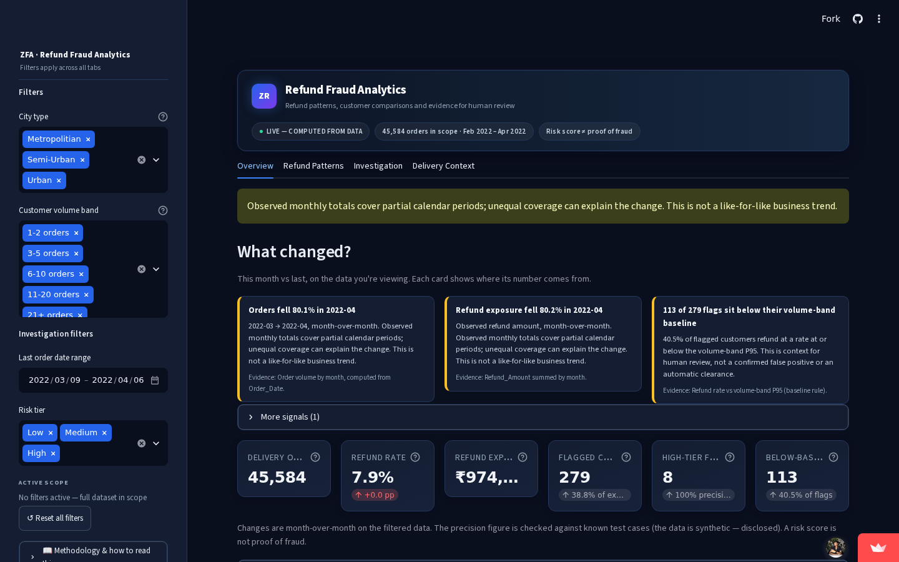
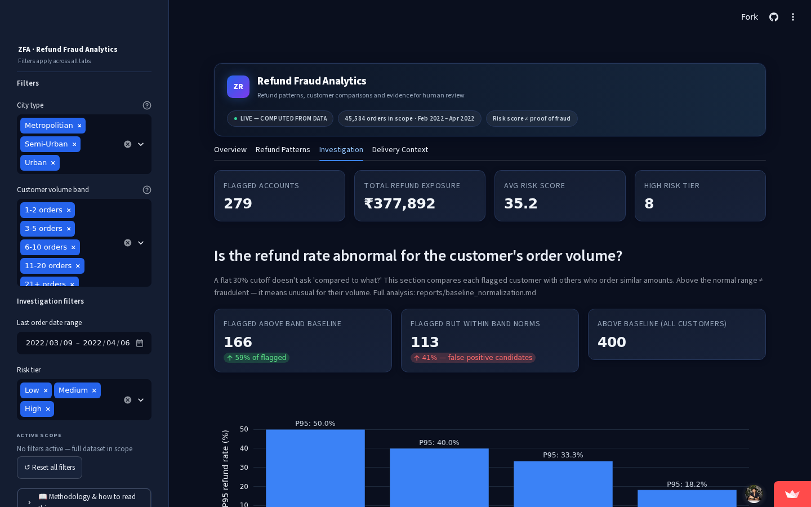

# Food-Delivery Refund Risk & Operations Analytics

A refund-review case study built around one question: **which customer records deserve a closer look, and what would a review policy cost?**

[Open the dashboard](https://zomato-refund-fraud-analytics-3xu24nq5hwbml78hkyirje.streamlit.app/) · [Executive findings](docs/EXECUTIVE_FINDINGS_REPORT.md) · [SQL queries](sql/fraud_queries.sql) · [Data dictionary](data/DATA_DICTIONARY.md) · [Evidence index](RESUME_EVIDENCE.md)

[](https://github.com/rishi-1603/zomato-refund-fraud-analytics/actions/workflows/ci.yml)



> **Data disclosure.** The delivery attributes come from a public dataset (45,584 orders). Customer IDs, refund events, amounts and risk labels are **synthetic and seeded**. No real fraud was detected and no real customer is implicated. This is an independent portfolio project, not an official Zomato product.

## 1. Project overview

An interactive Streamlit dashboard and reproducible Python/SQL analysis that help a refund-review team decide which customers to examine first. The project covers metric reconciliation, customer comparisons against order-volume baselines, a weighted review score, and a comparison of review policies at a fixed capacity.

## 2. Business problem

A high refund rate is easy to flag. Deciding whether it is unusual, and worth an analyst's time, is harder. Customers place different numbers of orders, investigations cost time, and a risk score cannot establish intent. A review team therefore needs three things: a fair comparison (rate against customers with similar order volume), a bounded queue, and an honest account of what a policy costs.

## 3. Analytical objectives

1. Reconcile headline refund KPIs between pandas and SQL.
2. Describe where refund value concentrates across customers, reasons and operating conditions.
3. Rank customers for review using a transparent, documented score, with its eligibility rule.
4. Test whether flagged behaviour is unusual for its order-volume band.
5. Compare review policies under explicit cost and recovery assumptions.
6. Check whether shared delivery attributes (riders, restaurants, drop cells) show a network pattern.
7. Monitor whether the score inputs drift over time.

## 4. Dataset source and context

| Item | Value | Provenance |
|---|---|---|
| Delivery orders | 45,584 | Public delivery dataset, unmodified (`data/raw/`) |
| Observed customer IDs | 9,895 | Generated from seed 42 (synthetic) |
| Refund requests | 3,596 | Generated (synthetic) |
| Refund value | ₹974,343.55 | Generated (synthetic) |
| Review pool (≥5 orders and refund rate >30%) | 279 customers | Derived |
| Refund value held by the review pool | 38.78% | Derived |

The order history runs from February to **6 April 2022**. Partial months are flagged on the dashboard, and their change badges are suppressed so that they are not read as a trend.

Field-level provenance, generated columns and metric definitions: [data dictionary](data/DATA_DICTIONARY.md).

## 5. Existing technical stack

- **Application:** Streamlit (5 tabs, sidebar filters, downloads).
- **Analysis:** pandas, NumPy, scikit-learn (model comparison), Plotly (charts).
- **SQL:** queries in `sql/`, validated against pandas on SQLite; PostgreSQL-oriented files are included for database review.
- **Testing and CI:** pytest (186 tests) and GitHub Actions.
- **Optional:** OpenAI or Gemini for narration. The app runs without any API key.

## 6. Analytical methodology

- **Eligibility rule:** at least five orders and a refund rate above 30%. This defines the 279-customer review pool.
- **Risk score:** a weighted formula: refund rate 40%, reason repetition 30%, refund frequency 20%, reason length 10%. The score ranks the pool. It is **uncalibrated**: a score of 70 is not a 70% probability of fraud. Details: [methodology](docs/risk_scoring_methodology.md).
- **Volume-band baseline:** each customer is compared with customers in the same order-volume band (1–2, 3–5, 6–10, 11–20, 21+ orders), using the band's P95 refund rate.
- **Policy economics:** three review policies are costed with an assumed ₹250 review cost, ₹100 false-positive friction and 50% recovery of a planted High customer's refund exposure. Sensitivity grid: [alert economics](reports/alert_economics.md).
- **Network check:** shared delivery-person, restaurant-cell and drop-cell components, each scored against the dataset baseline.
- **Drift monitor:** population stability index (PSI) on weekly score inputs.

## 7. Dashboard

Five tabs, one set of sidebar filters (city type, customer volume band, last-order date, risk tier):

| Tab | What it answers |
|---|---|
| Overview | Scope, headline metrics, and the highest-ranked records |
| Refund Patterns | Where refund value concentrates, reasons, and customer-level patterns |
| Investigation | Score components, volume-band context, and customer evidence |
| Delivery Context | Delivery time, rider rating and other operating conditions |
| Decision & Value | Capacity-limited review queue, cost and recovery scenarios, and a downloadable decision record |



The screenshots were captured before the most recent header change. The app's data and behaviour are unchanged, but the header differs slightly. A refreshed gallery is listed under future work.

## 8. Results and findings

**Concentration.** The 279-customer pool holds 38.78% of refund value (₹377,892 of ₹974,344). This is a descriptive result.

**Volume-band context.** 113 of the 279 flagged customers are at or below their volume band's P95 refund-rate baseline. The eligibility rule is applied before the baseline comparison, so this result describes the pool only. It is not a measured false-positive rate.

**Policy comparison** (assumed costs, planted labels):

| Policy | Reviews | Precision vs planted labels | Modelled net value |
|---|---:|---:|---:|
| High tier | 8 | 100.0% | ₹8,274 |
| High + Medium tiers | 115 | 87.8% | ₹92,125 |
| All flagged customers | 279 | 46.9% | ₹65,006 |

Under these assumptions the High + Medium policy returns the most modelled value. Break-even precision is 28.2%. These are modelled values, not realised savings. A real policy needs actual investigation costs and outcomes.

**Network check.** The delivery-person permutation test gives p = 0.76, with no evidence of High-label clustering beyond chance. A 788-customer restaurant-cell component reflected a busy location, so the analysis ranks components by excess refund rate, not by size.

**Stability.** The weekly PSI monitor reports the monitored features as stable in the seeded stream ([report](reports/drift_monitor.md)).

**Reconciliation.** Eight headline KPIs match between pandas and SQL, with zero mismatches ([report](reports/kpi_reconciliation.md)).

**Evidence tool.** The deterministic investigation tool passed a 12-case authored benchmark: 6/6 answerable questions grounded, and 6/6 unanswerable or unknown-ID questions refused ([report](reports/investigator_eval.md)).

Full findings: [executive summary](reports/executive_summary.md) and [executive findings](docs/EXECUTIVE_FINDINGS_REPORT.md).

## 9. Installation

Use Python 3.11, matching CI. From the repository root:

```bash
python -m venv .venv
source .venv/bin/activate          # Windows: .venv\Scripts\activate
python -m pip install -r requirements.txt

streamlit run dashboard/app.py

# In another terminal, with the same environment active:
python -m pytest -q
```

To reproduce the main reports:

```bash
python scripts/validate_risk_score.py
python scripts/kpi_reconciliation.py
python scripts/model_comparison.py
python scripts/network_analysis.py
python scripts/alert_economics.py
python scripts/drift_monitor.py
python scripts/investigator_eval.py
python scripts/external_validation.py
```

The dashboard and evidence tools need no API key. Optional narration reads `OPENAI_API_KEY` or `GOOGLE_API_KEY` from environment variables. Keep credentials out of the repository. If the hosted app is asleep or unavailable, see the [local demo guide](docs/DEMO_FALLBACK_GUIDE.md).

## 10. Project structure

| Path | Contents |
|---|---|
| `dashboard/` | Streamlit app, KPI functions and evidence tools |
| `data/` | Public delivery inputs, generated refund fields, metric definitions and external reference data |
| `sql/` | Business queries, volume-band baselines and Pareto analysis |
| `scripts/` | Reconciliation, validation and analysis scripts |
| `evals/` | Authored investigator benchmark |
| `notebooks/` | Data generation, exploration, scoring and database walkthroughs |
| `tests/` | Data, analytical, dashboard and evidence-tool checks |
| `reports/`, `docs/` | Findings, methodology and verification records |

## 11. Limitations

- The refund layer is **synthetic**, and the risk labels are **planted**. Results describe the simulation, not real customers.
- There are no confirmed investigation outcomes, so precision values measure agreement with planted labels only.
- Scores depend on the eligible population. Customers with short histories can show extreme rates.
- Delivery-attribute findings are descriptive associations, not causes.
- Policy values use assumed costs and recovery rates. They are not realised savings.
- The live LLM narration path has not been run in the verification environment. Only the deterministic path is verified.
- The 6 April 2022 end date means the final month is partial.

The full list is in [assumptions and limitations](reports/assumptions_and_limitations.md).

## 12. Future improvements

- Collect investigator outcomes to measure precision on real reviews, not planted labels.
- Measure customer friction before any policy pilot.
- Re-run and document the live LLM narration path with a key on a local machine.
- Refresh the screenshot gallery and add a before/after comparison of the interface.
- Run a PostgreSQL pass of the SQL files.

## 13. Repository links

[Assumptions](reports/assumptions_and_limitations.md) · [Rules versus models](reports/model_comparison.md) · [Decision workflow](docs/BUSINESS_VALUE_DECISION_ENGINE.md) · [Publication audit](docs/FINAL_RELEASE_AUDIT.md) · [Security audit](docs/SECURITY_AUDIT.md)
