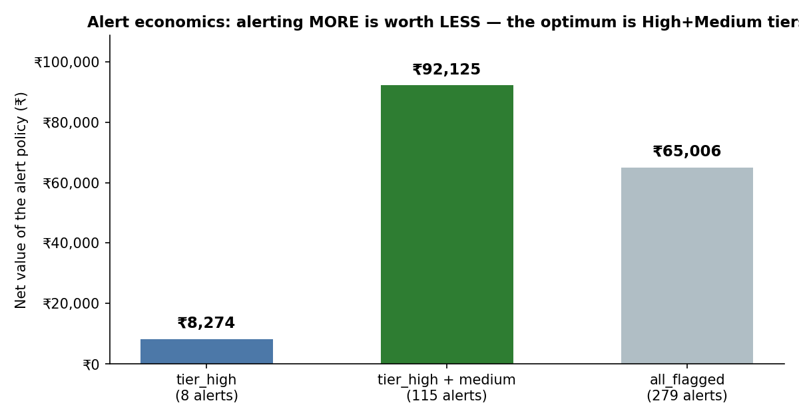
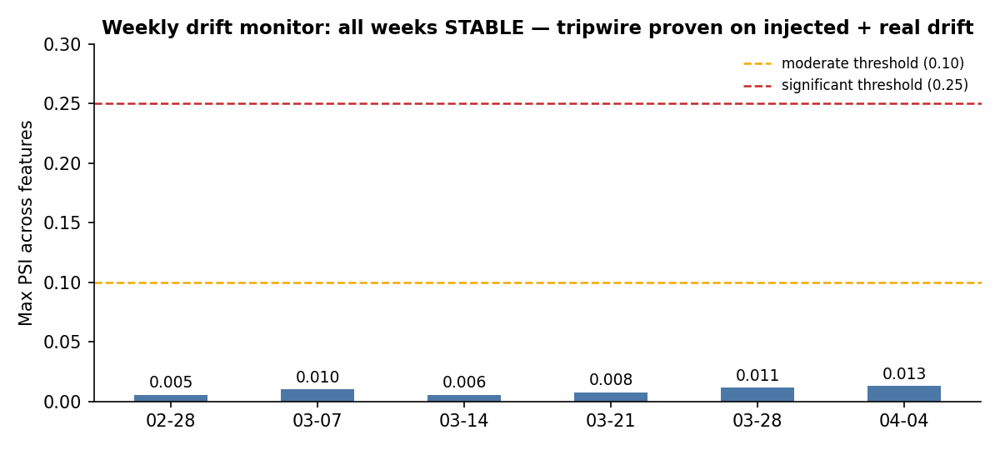

# Food-Delivery Refund Risk & Operations Analytics

**An analytics-first portfolio project** that turns a public delivery-orders dataset into a reconciled KPI layer, operational analysis, human-review workflow, and a carefully bounded model comparison.

[Dashboard URL (authentication may be required)](https://zomato-refund-fraud-analytics-3xu24nq5hwbml78hkyirje.streamlit.app/) · [Executive summary](reports/executive_summary.md) · [KPI reconciliation](reports/kpi_reconciliation.md) · [SQL queries](sql/fraud_queries.sql) · [Score validation](reports/score_validation.md) · [Model comparison](reports/model_comparison.md) · [Data dictionary](data/DATA_DICTIONARY.md) · [Tests](tests/) · [Release gates](docs/RELEASE_GATES.md)

[](https://github.com/rishi-1603/zomato-refund-fraud-analytics/actions/workflows/ci.yml) 

> ### 🧭 Recruiter & Interview Verification Hub (October 2026 Comprehensive Upgrade)
> - **Direct Resume Evidence Index:** [RESUME_EVIDENCE.md](RESUME_EVIDENCE.md) *(Claims, definitions, reproduction commands, & test files)*
> - **Executive Risk Operations Brief:** [docs/EXECUTIVE_FINDINGS_REPORT.md](docs/EXECUTIVE_FINDINGS_REPORT.md) *(Pareto exposure, false-positive volume trap, & queue policy)*
> - **Operations Triage Funnel:** [docs/REFUND_RISK_FUNNEL.md](docs/REFUND_RISK_FUNNEL.md) *(Visual breakdown: 9,895 -> 4,120 -> 279 -> 115 High/Med Alerts)*
> - **Investigator Case Workflow:** [docs/INVESTIGATOR_CASE_WORKFLOW.md](docs/INVESTIGATOR_CASE_WORKFLOW.md) *(Triage interface, volume-band comparison, & audit fields)*
> - **Alert Economics Sensitivity:** [docs/ALERT_ECONOMICS_SENSITIVITY.md](docs/ALERT_ECONOMICS_SENSITIVITY.md) *(Cost matrix: review cost vs fraud prevention vs friction)*
> - **PSI Drift Monitoring Runbook:** [docs/PSI_MONITORING_RUNBOOK.md](docs/PSI_MONITORING_RUNBOOK.md) *(Weekly population stability index calculation & thresholds)*
> - **Offline Demo Fallback Guide:** [docs/DEMO_FALLBACK_GUIDE.md](docs/DEMO_FALLBACK_GUIDE.md) *(Local instant execution & smoke-test instructions)*

---




> **Data and claims notice:** The base order dataset is public; **refund events, refund amounts, and risk labels are synthetic and seeded**. No real fraud was detected and no real customer is implicated. The score is an uncalibrated review-prioritization heuristic—not a fraud probability, verdict, or basis for automated customer action. This is an independent portfolio project, not an official Zomato product.

## Executive summary

The operational question is not merely “Which model has the highest AUC?” It is: **Can a review team reconcile its numbers, prioritize a fixed queue, understand false-positive risk, and see who is excluded before scoring starts?**

This project pairs eight Python/SQL KPI checks with a Streamlit investigation console, customer-volume baselines, a review-queue score, model and network analyses, alert-economics scenarios, drift monitoring, and an evidence-grounding audit. The central decision is to **keep the interpretable rule score for the current review queue, fix the eligibility funnel, and keep humans responsible for customer decisions**. All refund-risk performance results are measured against planted labels, not independently confirmed fraud.

**Role emphasis:** Data Analyst first—SQL, KPI definitions, data provenance, reconciliation, distribution and cohort analysis, operational recommendations, and dashboard communication. Data Science supports that work through out-of-fold model evaluation, permutation testing, decision economics, drift metrics, and a bounded evidence-layer evaluation.

## Project at a glance

| Measure | Result | How to interpret it |
|---|---:|---|
| Delivery-order rows | **45,584** | Public base dataset, augmented with synthetic refund fields |
| Observed customer IDs | **9,895** | Customer-level analysis population |
| Original / synthetic columns | **20 / 4 (83% / 17%)** | `Customer_ID`, `Refund_Requested`, `Refund_Reason`, and `Refund_Amount` are generated |
| Refund requests / synthetic refund amount | **3,596 / ₹974,344** | Historical amount in the simulation—not verified loss |
| Customers in current score pool | **279** | Eligibility: at least 5 orders and refund rate above 30% |
| Refund amount held by score pool | **38.78%** | Queue-sizing statistic, not proof of abuse |
| High tier at current threshold | **8; 100% precision against planted labels** | Small synthetic validation slice (n=8) |
| End-to-end High-tier recall | **2.7% (8/299 generated High labels)** | The existing funnel and final cut exclude most generated High labels |

The validation reports use their documented populations: the seed-recovery audit has 299 generated High labels; the full-base model comparison contains 298 High labels among observed-order customers because one generated customer has no order record. Do not compare these denominators without that context.

## 1. Analyst case study: from source data to review decisions

### Business questions

| Question | Analysis / artifact | What a team could do with it |
|---|---|---|
| Do the dashboard, Python calculations, and SQL agree? | Eight-KPI reconciliation (`reports/kpi_reconciliation.md`) | Resolve definition drift before numbers reach a review meeting |
| Where is synthetic refund amount concentrated? | Pareto analysis and customer ranking | Size a review queue; concentration alone is never evidence of intent |
| Is a high refund rate unusual for the customer's order volume? | P95 baselines by volume band | Separate small-denominator noise from rates unusual for comparable activity |
| What is hidden by the eligibility rule? | Funnel coverage, capacity metrics, and concrete error cases | Measure recall at fixed review capacity before changing score weights |
| What does a review policy cost under stated assumptions? | Alert-economics model and sensitivity grid | Compare review policies and break-even precision; replace assumptions with real operating data before use |
| Does the source data show delivery-operation patterns? | External provenance audit of original public columns | Explore traffic, weather, and rating patterns independently of synthetic refund labels |

### Selected findings and decisions

- **KPI parity:** Eight headline metrics match between independent pandas and SQL calculations (zero discrepancies within the documented tolerance). The SQL reconciliation uses an SQLite adaptation of the PostgreSQL-oriented business-query logic.
- **Refund-value concentration:** the top 10% of customers by synthetic refund value account for **75.6%** of that value. This can support queue-capacity planning; it does not identify fraud.
- **Volume-adjusted review:** **113 of 279** currently flagged customers (40.5%) are at or below their order-volume band's P95 refund-rate baseline. This is a screening flag—not a confirmed false-positive rate or an automatic reason to clear an account.
- **Coverage before model complexity:** **131 of 299** generated High labels enter the current eligible pool; the High tier contains 8. A score can rank only the customers it is allowed to see. The documented next experiment is to score customers with at least one refund and report recall at fixed review capacity.
- **Public delivery-column analysis:** recomputation on the 20 original columns finds median delivery times of 20/27/27/31 minutes across Low/Medium/High/Jam traffic categories, a 28-minute median for Cloudy weather, and mean rating 4.634. These are descriptive associations—not causal estimates.

### Alert economics: price a policy, not just a score

The alert-economics script reuses the dashboard's `build_risk_table` and makes its assumptions explicit: ₹250 review cost per alert, ₹100 false-positive friction cost, and 50% recovery of a planted High customer's exposure.

| Policy | Alerts | Precision | Recall within eligible pool | Modeled net value |
|---|---:|---:|---:|---:|
| High tier | 8 | 100.0% | 6.1% | ₹8,274 |
| High + Medium | 115 | 87.8% | 77.1% | **₹92,125** |
| All flagged | 279 | 46.9% | 100.0% | ₹65,006 |

At the base assumptions, the model selects **High + Medium** and estimates break-even precision at **28.2%**. These are scenario calculations over synthetic labels and assumed costs—not realized savings, a fraud-program P&L, or a recommendation to change customer treatment. Sensitivity analysis is in [`reports/alert_economics.md`](reports/alert_economics.md).

## 2. Data provenance, SQL, and product

### Source and scope

| Component | Provenance | Size / grain |
|---|---|---|
| Delivery, timing, traffic, weather, rating, and location fields | Public Kaggle delivery-orders dataset | 20 original columns across 45,584 orders |
| Customer identifiers and refund fields | Seeded synthetic layer | 4 generated columns, added for method testing |
| Risk labels | Generated and recovered from the seed | Validation oracle for this simulation only; not independent investigator outcomes |
| External drift-validation data | Committed `seaborn-data/flights` copy | 144 monthly airline-passenger observations, 1949–1960; provenance/license in [`data/external/README.md`](data/external/README.md) |

Column definitions: [`data/DATA_DICTIONARY.md`](data/DATA_DICTIONARY.md) · score definition: [`docs/risk_scoring_methodology.md`](docs/risk_scoring_methodology.md) · limitations: [`reports/assumptions_and_limitations.md`](reports/assumptions_and_limitations.md).

### KPI and SQL layer

The dashboard's core metric definitions live in [`data/metrics.json`](data/metrics.json). PostgreSQL-oriented files in [`sql/`](sql/) cover order/refund summaries, top customers, repeated reasons, city patterns, exposure concentration, and volume-band baselines. [`scripts/kpi_reconciliation.py`](scripts/kpi_reconciliation.py) independently computes eight KPIs in pandas and SQL and documents the SQLite adaptation used for automated parity testing.

### Investigation dashboard

[Open the Streamlit dashboard URL (authentication may be required)](https://zomato-refund-fraud-analytics-3xu24nq5hwbml78hkyirje.streamlit.app/)

The URL responds, but an unauthenticated smoke check currently redirects to Streamlit authentication; public viewer access has not been confirmed.


The product surfaces an overview, refund patterns, investigation detail, and delivery context. Reviewers can filter the watchlist, inspect score signals, compare a customer with a volume-band baseline, and export the queue. The optional LLM layer can narrate evidence retrieved by deterministic tools; without an API key, the tools can return the evidence directly.

## 3. Applied Data Science: evaluation, not model shopping

### Transparent score and rules-versus-ML comparison

The current score combines four MinMax-scaled signals over the eligible pool: refund rate (40%), repeated reason (30%), refund frequency (20%), and average reason length (10%). Eligibility itself uses at least 5 orders and a refund rate above 30%; because refund rate is also the largest score component, this is a **triage score inside a pre-filtered pool**, not an independent detector.

Five-fold stratified out-of-fold comparisons use planted High labels. Scope matters: the eligible pool has a 46.95% positive rate, while the observed full customer base has a 3.01% positive rate.

| Eligible-pool system (n=279) | ROC-AUC | PR-AUC | Precision@8 | Precision@20 |
|---|---:|---:|---:|---:|
| Rule score | 0.9422 | 0.9403 | 100% | 100% |
| Logistic Regression | 0.9611 | 0.9663 | 100% | 100% |
| Gradient Boosting | 0.9782 | 0.9813 | 100% | 100% |

On the full observed customer base, the supervised models also rank the planted labels highly (Logistic Regression ROC-AUC/PR-AUC **0.9939/0.9541**; Gradient Boosting **0.9872/0.9357**). Those full-base values are not a real-world fraud benchmark: the synthetic generator creates behaviour from the planted labels.

**Decision:** do not replace the transparent rule score based on a tail-ranking AUC gain when all three systems tie at the tested top-8 and top-20 review cuts. The model comparison's useful design lesson is coverage: the rule funnel excludes low-volume customers before scoring. Full protocol and caveats: [`reports/model_comparison.md`](reports/model_comparison.md).

### Network analysis: test the ring hypothesis, accept the null

Three shared-attribute networks use delivery-person, restaurant-cell, and drop-cell fields from the public order dataset. A 200-shuffle permutation test finds **2.0699%** of High-risk pairs linked versus a null mean of **2.1484%** (**p = 0.76**). The result does **not** support clustering on shared delivery people beyond chance. The project does not claim to have discovered fraud rings.

Raw connected-component size also over-merges busy locations: a 788-customer restaurant-cell component was screened as a busy area, not a ring. A density screen ranks small components by excess refund rate for possible human review. Shared attributes are associations, never proof of collusion. See [`reports/network_analysis.md`](reports/network_analysis.md).

### Drift monitoring and external validation



The weekly monitor reports the seeded order stream as **STABLE** across six weeks (maximum PSI 0.0129); that stationary synthetic stream alone cannot prove the tripwire works. Tests inject distribution and category shifts and require the PSI grade to move to significant. Separately, the committed 1949–1960 airline-passenger series shifts from a 1949–1952 reference mean of 158.4 to 413.5 in 1957–1960; **PSI = 11.8773** and the tripwire fires. This validates the PSI implementation on a public real-drift example—not fraud-model drift in a live production system. Reports: [`reports/drift_monitor.md`](reports/drift_monitor.md) · [`reports/external_validation.md`](reports/external_validation.md).

### Evidence-tool evaluation

The investigator benchmark contains 6 answerable and 6 unanswerable cases. The deterministic evidence layer passed **6/6** grounded-answer cases and **6/6** refusal cases, with **zero fabricated numbers** and no verdict-like schema fields. This evaluates the evidence tools against the committed CSV; it does **not** validate an open-ended LLM narrative or general language ability. See [`reports/investigator_eval.md`](reports/investigator_eval.md) and [`evals/investigator_benchmark.json`](evals/investigator_benchmark.json).

## 4. Reproduce locally

The GitHub Actions workflow uses Python 3.11. From the repository root:

```bash
python -m venv .venv
source .venv/bin/activate          # Windows: .venv\Scripts\activate
python -m pip install -r requirements.txt

# Reproduce the core score, model-comparison, and new analysis reports
python scripts/validate_risk_score.py
python scripts/model_comparison.py
python scripts/network_analysis.py
python scripts/alert_economics.py
python scripts/drift_monitor.py
python scripts/investigator_eval.py
python scripts/external_validation.py

# Launch the dashboard
streamlit run dashboard/app.py

# Run all automated tests
python -m pytest -q
```

Notebook-only extras (Jupyter, plotting, and PostgreSQL drivers) are listed in comments in [`requirements.txt`](requirements.txt); the deployed dashboard and CI suite use the lean deployment set.

## Repository map

```text
├── data/                 # public order rows, synthetic refund layer, metric registry, external drift sample
├── notebooks/            # generation, EDA, scoring, and SQL walkthroughs
├── sql/                  # documented operational queries and baselines
├── dashboard/            # Streamlit review console and evidence tools
├── scripts/              # scoring, model comparison, networks, economics, drift, provenance, evals
├── evals/                # investigator benchmark cases
├── reports/              # KPI, model, error, network, economics, drift, and validation reports
├── docs/                 # methodology, governance, release gates, decision log
└── tests/                 # 138 automated tests across the pipeline and analysis modules
```

## Limitations and responsible-use boundary

- Refund events, amounts, and risk labels are synthetic. Performance against planted labels is **not** validation against actual fraud outcomes.
- The High-tier result is based on eight cases in a clean synthetic setup. It should not be generalized to a real customer population.
- The eligibility rule partly reuses refund rate in the score; MinMax scaling is population-relative. Thresholds can move when the candidate pool changes.
- High refund rates can arise from small denominators, delivery failures, or other service issues. The project does not establish intent or cause.
- Network components are shared-attribute associations. The permutation test found no significant clustering on delivery-person links; component size alone is not evidence of a ring.
- Alert-economics figures depend on assumed review/friction costs and recovery rate. They are not realized savings or a real P&L forecast.
- The drift monitor is tested on seeded data plus a separate public drift sample; it is not monitoring a live fraud system.
- The investigator eval covers a small authored benchmark of deterministic tools; optional generative narration is not scored by that benchmark.

For the governance checklist and evidence trail, see [`docs/RELEASE_GATES.md`](docs/RELEASE_GATES.md) and [`reports/FINAL_RELEASE_REPORT.md`](reports/FINAL_RELEASE_REPORT.md). Every bug found during development is recorded with its fix and lesson in [`docs/ascension/DECISIONS.md`](docs/ascension/DECISIONS.md). Latest audited suite: **138 tests passed**; The current publication-audit test result is recorded in `docs/FINAL_RELEASE_AUDIT.md`; deployment verification is reported separately.

### Interpreting monthly changes

The supplied order history ends on 6 April 2022. April-versus-March totals are not like-for-like full months. The dashboard flags partial observed calendar coverage and suppresses order/exposure KPI change badges in that case. Baseline flags remain review context, not confirmed false positives or automatic clearance.
