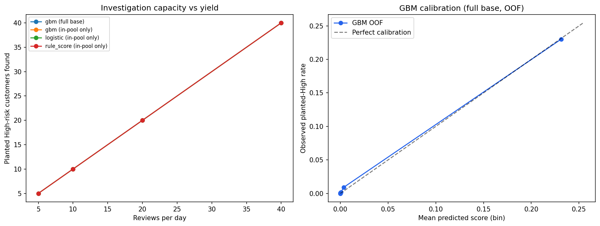

# Rules vs Machine Learning — the honest comparison
### Would a trained model beat the refund-fraud risk score?

> Generated by `scripts/model_comparison.py` · protocol: **5-fold stratified OOF predictions; rule score fitted-free; labels = planted High**
>
> ⚠️ **synthetic refund layer draws behaviour FROM the planted label; metric gaps measure method and coverage, not real-world superiority**.

---

## 1. In-pool: like-for-like on the 4 signals (279 eligible customers)

| System | ROC-AUC | PR-AUC | Precision@8 | Precision@20 | Recall@20 |
|---|---|---|---|---|---|
| rule_score | 0.9422 | 0.9403 | 1.0 | 1.0 | 0.1527 |
| logistic_regression | 0.9606 | 0.966 | 1.0 | 1.0 | 0.1527 |
| gradient_boosting | 0.9774 | 0.9804 | 1.0 | 1.0 | 0.1527 |

**Key finding — head parity:** at the cut sizes a fraud team actually reviews (top 8–20), all three systems are *identical* — 100% planted-High precision. The AUC gap lives in the ranking tail, not the head. A rule score that is as accurate at the top as a trained model, while staying explainable in an investigation room, is hard to justify replacing.

### Rule tiers -> empirical planted-High rates

| Tier | n | Planted-High rate |
|---|---|---|
| Low | 164 | 18.3% |
| Medium | 107 | 86.9% |
| High | 8 | 100.0% |

## 2. Full base: the coverage question (all 10,000 customers)

The rule pipeline can only ever flag the eligible pool — which contains **131 of 298 planted High-risk customers who appear in the order data (44.0%)**. A model scored on everyone has no such ceiling. (One planted-High customer never appears in the orders data and is excluded from these counts.)

| System | ROC-AUC | PR-AUC | Recall@10 | Recall@20 | Recall@40 |
|---|---|---|---|---|---|
| logistic_regression | 0.9939 | 0.9541 | 0.0336 | 0.0671 | 0.1342 |
| gradient_boosting | 0.9872 | 0.9356 | 0.0336 | 0.0671 | 0.1342 |

### GBM calibration (OOF, full base)

| Bin | n | Mean score | Observed planted-High rate |
|---|---|---|---|
| 1 | 1591 | 0.0001 | 0.0% |
| 2 | 1642 | 0.0001 | 0.0% |
| 3 | 1086 | 0.0001 | 0.1% |
| 4 | 721 | 0.0001 | 0.0% |
| 5 | 1146 | 0.0002 | 0.1% |
| 6 | 1257 | 0.0007 | 0.2% |
| 7 | 1222 | 0.0034 | 0.9% |
| 8 | 1230 | 0.2315 | 23.0% |

## 3. Investigation capacity

| System | Reviews | Planted High found | Precision |
|---|---|---|---|
| rule_score (in-pool only) | 5 | 5 | 100.0% |
| rule_score (in-pool only) | 10 | 10 | 100.0% |
| rule_score (in-pool only) | 20 | 20 | 100.0% |
| rule_score (in-pool only) | 40 | 40 | 100.0% |
| logistic (in-pool only) | 5 | 5 | 100.0% |
| logistic (in-pool only) | 10 | 10 | 100.0% |
| logistic (in-pool only) | 20 | 20 | 100.0% |
| logistic (in-pool only) | 40 | 40 | 100.0% |
| gbm (in-pool only) | 5 | 5 | 100.0% |
| gbm (in-pool only) | 10 | 10 | 100.0% |
| gbm (in-pool only) | 20 | 20 | 100.0% |
| gbm (in-pool only) | 40 | 40 | 100.0% |
| gbm (full base) | 5 | 5 | 100.0% |
| gbm (full base) | 10 | 10 | 100.0% |
| gbm (full base) | 20 | 20 | 100.0% |
| gbm (full base) | 40 | 40 | 100.0% |

**Reading the table:** every system finds only planted abusers in its top 40 — precision is saturated at the head for all of them. The meaningful difference is *how far each system can see*: in-pool systems stop at the eligible pool, the full-base model keeps finding abusers beyond it.

## 4. Error catalog (GBM, full base, top-20 cut)

- False positives in the top 20 by order-volume band: {'1-2': 0, '3-5': 0, '6-10': 0, '11+': 0}
- Missed planted High by volume band: {'3-5': 154, '6-10': 82, '1-2': 40, '11+': 1}
- Missed High inside the rule funnel: 117 · outside it: 160

## 5. The verdict

> **Do NOT swap the rule score for a model. At investigation-sized cut sizes the transparent rule score matches both models exactly (precision@8 and @20 = 100% for all three systems) — the AUC gap (0.942 rules vs 0.977 GBM) lives in the tail of the ranking, not the head a fraud team actually reviews. ML's real edge is coverage: 160 of the planted abusers missed at the top-20 cut sit OUTSIDE the eligibility funnel and are invisible to the rule pipeline. Ship the hybrid: keep rule-based triage for investigation (transparent, auditable), and fix the funnel — score the full customer base so low-volume abusers are visible at all. Note also that logistic regression ≈ GBM here: the simpler model pays.**

## 6. Limitations

1. Synthetic refund layer; planted labels drive behaviour — models recover them almost by construction. On real data the metric gaps would be far smaller.
2. OOF predictions are honest for the model families, but no temporal split is possible (the generator has no deployment-time dimension).
3. The rule score is fixed and interpretable; the models need retraining and monitoring — operational cost is part of the comparison.
4. 'Planted High' is a proxy for fraud intent; real ground truth comes from investigation outcomes, which this dataset does not contain.
5. Precision@8 parity matters because the shipped High tier has 8 members at 100% precision — matching that bar is the requirement for any replacement.

---

*Numbers pinned by `tests/test_model_comparison.py` against `reports/model_comparison_metrics.json`.*